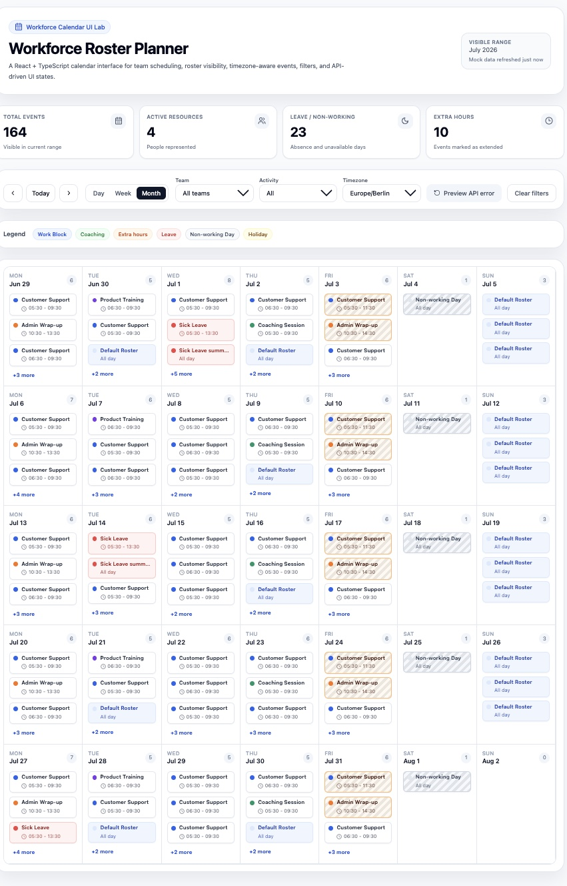
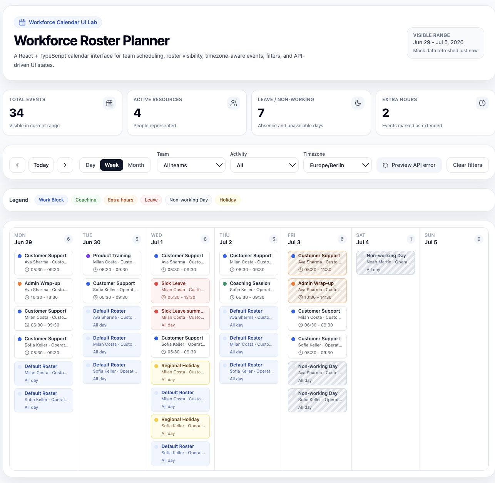
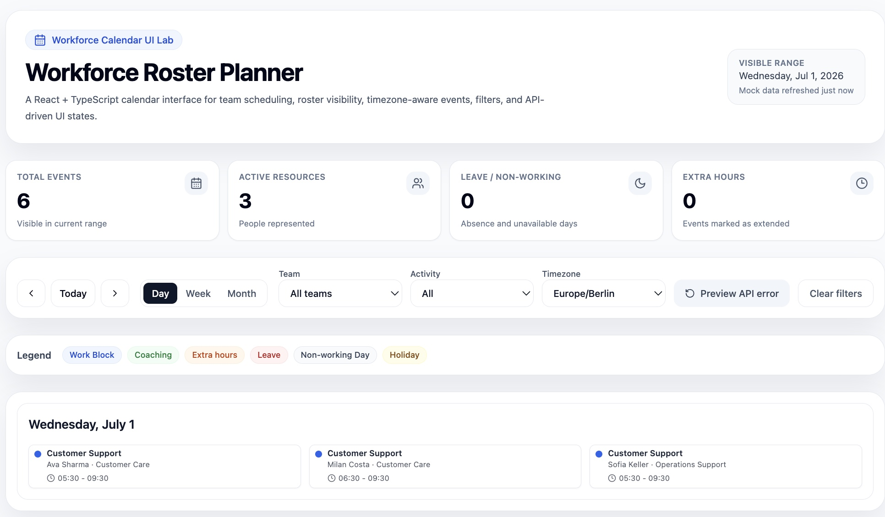
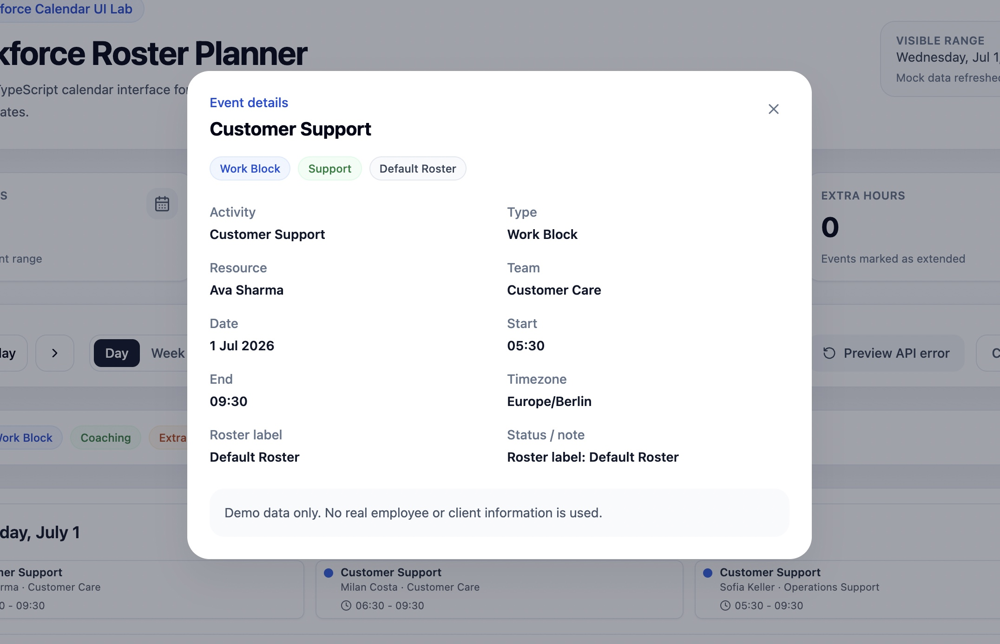
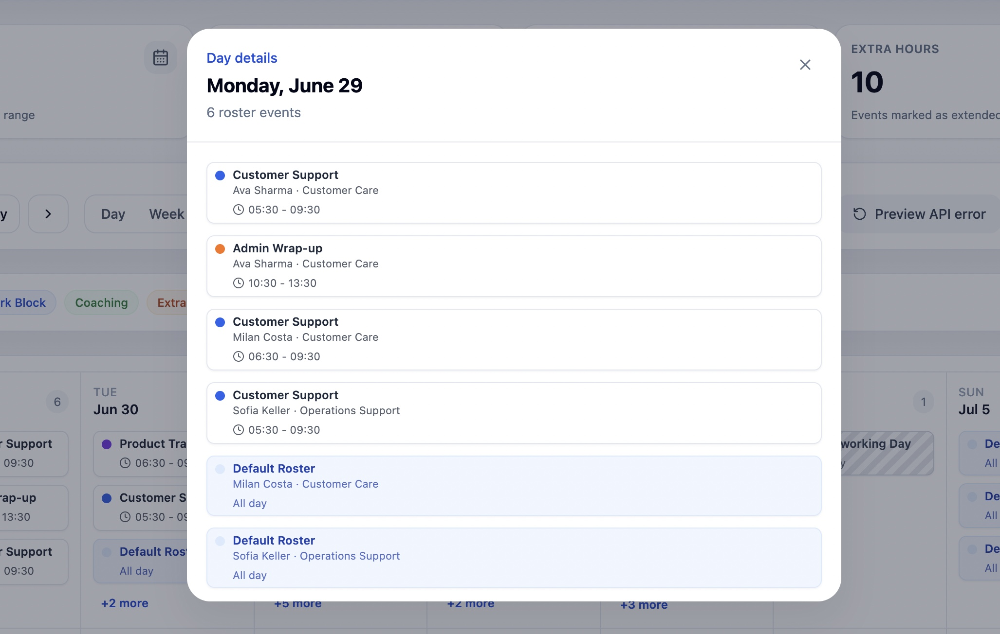
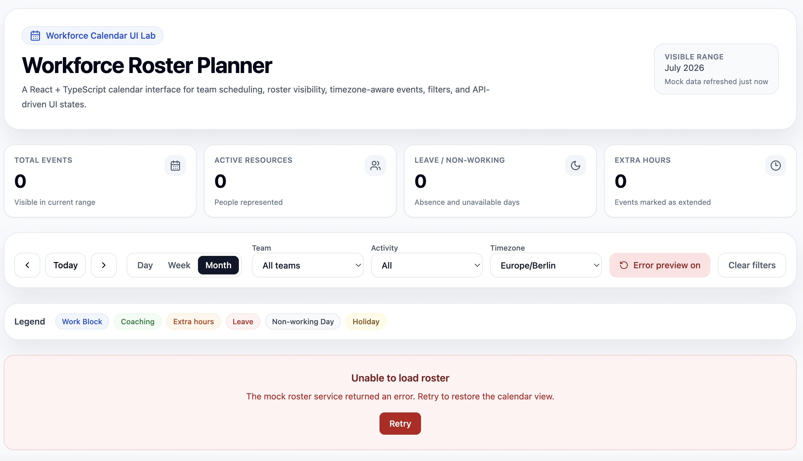

# Workforce Calendar UI Lab

A React + TypeScript workforce-calendar demo focused on calendar correctness, timezone boundaries, asynchronous data, and keyboard-accessible interactions. All data is synthetic.

## Live Demo

- Live Demo: https://workforce-calendar-ui-lab.vercel.app
- GitHub Repo: https://github.com/N-Mangla/workforce-calendar-ui-lab

## Why I Built This

Scheduling interfaces are deceptively complex: they combine dense calendar layouts, async data loading, filters, event categorization, accessible details panels, and edge states such as empty results or service errors. This project packages those product UI patterns into a public portfolio demo with safe, generic mock data.

## What This Demonstrates

- Building complex React + TypeScript product interfaces
- Separating API models from UI rendering models
- Handling async loading, retry, and error states
- Designing dense calendar UI with readable event density
- Creating reusable components and testable transformation logic
- Managing calendar filters, view modes, and timezone-aware event display

## Features

- Day, week, and month roster calendar views
- Compact dashboard metrics for visible events, active resources, leave/non-working time, and extra hours
- Month view density management with a maximum of three events per day and a clickable `+X more` details panel
- Event details modal with activity, resource, team, date, time, timezone, type, and notes
- Team, activity, timezone, and view-mode controls
- Fake API service with realistic loading, retry, and error states
- Timezone-selected placement of timed events, including overnight shifts and midnight end boundaries
- Timezone-aware UTC query boundaries for mock roster data, including daylight-saving transitions
- Keyboard-accessible event and day-details dialogs: Escape to close, Tab containment, and focus restoration
- Reusable UI primitives for badges, empty states, error states, loading overlays, and event cards
- Unit-tested roster API-to-calendar transformation logic

## Tech Stack

- React 18
- TypeScript
- Vite
- Tailwind CSS
- TanStack Query
- Zustand
- date-fns
- Vitest
- React Testing Library

## Engineering Decisions

**Calendar dates vs. instants.** A day cell represents a calendar date, while timed events represent timestamp intervals. Timed events appear in every day they overlap **in the selected IANA timezone**. Intervals use an exclusive end: an event ending at midnight does not occupy the next day. Synthetic all-day markers retain their calendar-date labels when the selected timezone changes.

**Timezone-aware range requests.** Day/week/month navigation produces a visible calendar range. The query layer converts its dates to UTC bounds at midnight in the selected timezone, using a half-open `[start, end)` interval. This matters when a calendar day lasts 23 or 25 hours during daylight-saving transitions. The mock API derives synthetic roster dates from those timezone-aware bounds.

**Avoiding stale UI.** Navigation updates the visible range immediately. API requests use a short debounce; during that gap, data from the previous range is not shown under the new heading. TanStack Query owns fetched data, caching, and retry/error state, while Zustand owns view mode, filters, and timezone selection.

**Dialogs and keyboard navigation.** Event and day-details dialogs move focus inside when opened, handle Escape, contain Tab navigation, and return focus to the opener when it still exists.

### Data flow

```text
Toolbar: calendar view / date / filters / selected timezone
                         |
               Visible calendar range
                         |
         Debounced range + zoned UTC query bounds
                         |
         TanStack Query -> synthetic roster API
                         |
               transformRosterEvents()
                         |
                  CalendarEvent[]
                         |
        Day / week / month overlap + event cards
                         |
             Accessible details dialogs
```

The project uses an independent mock service and does not implement real employee scheduling, backend persistence, or enterprise-grade timezone disambiguation for every possible historical/ambiguous local time.

## Quality Checks

GitHub Actions runs the checks below on pull requests targeting `main` and pushes to `main`. It uses Node.js 22 and a clean dependency install.

```bash
npm ci
npm test
npm run lint
npm run build
```

Tests use Vitest and React Testing Library and cover API-to-UI transformations, range consistency during rapid navigation, multi-day and midnight event boundaries, timezone placement (including Berlin DST and Kolkata), mock API query dates, and dialog keyboard/focus behavior. The build command includes TypeScript checking followed by a Vite production build.

[View CI runs](https://github.com/N-Mangla/workforce-calendar-ui-lab/actions/workflows/ci.yml) · [Merged engineering changes](https://github.com/N-Mangla/workforce-calendar-ui-lab/pulls?q=is%3Apr+is%3Amerged)

## Screenshots

| Month View | Week View | Day View |
|---|---|---|
|  |  |  |

| Day Details Modal | Event Details Modal |
|---|---|
|  |  |

| Error State |
|---|
|  |

## Local Run Instructions

```bash
npm ci
npm run dev
```

## Confidentiality Note

This is an independent demo project using fake roster data. It does not contain proprietary code, real client data, internal API contracts, or confidential implementation details.